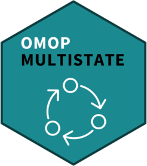

<!-- README.md is generated from README.Rmd. Please edit that file -->

```{r, include = FALSE}
knitr::opts_chunk$set(
  collapse = TRUE,
  comment = "#>",
  fig.path = "man/figures/README-",
  out.width = "100%"
)
```

# OmopMultistate 

<!-- badges: start -->
[](https://lifecycle.r-lib.org/articles/stages.html#experimental)
[](https://github.com/OHDSI/OmopMultistate/actions/workflows/R-CMD-check.yaml)
[](https://app.codecov.io/gh/OHDSI/OmopMultistate)
<!-- badges: end -->

**OmopMultistate** estimates how individuals move between clinically meaningful
states over time using cohort records from the OMOP Common Data Model. Each
state is represented by a cohort definition, while a transition matrix declares
which movements between states are possible.

The package provides a workflow to:

- prepare an OMOP `cohort_table` in the long format used by
  [mstate](https://hputter.github.io/mstate/);
- estimate state occupation probabilities overall or for specific initial
  states;
- repeat the analysis across user-defined strata; and
- return results as a standard `summarised_result` object and visualise them
  over time.

## Ecosystem

*OmopMultistate* is part of the ecosystem of packages defined by
[omopgenerics](https://darwin-eu.github.io/omopgenerics/). For more details on
the ecosystem you can read the [Tidy R programming with the OMOP Common Data Model](https://ohdsi.github.io/Tidy-R-programming-with-OMOP/)
book.

## Tested sources

| Source | Driver | CDM reference | Status |
|------------------|------------------|------------------|------------------|
| Local R data frame | N/A | `omopgenerics::cdmFromTables()` | [](https://github.com/OHDSI/OmopMultistate/actions/workflows/test-regular.yaml) |
| In-memory DuckDB database | duckdb | `CDMConnector::cdmFromCon()` | [](https://github.com/OHDSI/OmopMultistate/actions/workflows/test-regular.yaml) |

## Installation

You can install the development version of OmopMultistate from [GitHub](https://github.com/) with:

``` r
# install.packages("pak")
pak::pak("OHDSI/OmopMultistate")
```

## Example

The following example models acetaminophen treatment, discontinuation, and
restarting treatment, with death as an absorbing state. It uses the synthetic
`synpuf-1k` dataset, which `omock` downloads on first use, and a temporary DuckDB
database. This example requires `omock`, `CohortConstructor`, `CodelistGenerator`,
`CDMConnector`, and `duckdb`; plotting also requires `visOmopResults`, `ggplot2`,
and `scales`.

The function help pages provide smaller examples using the bundled `GiBleed`
dataset and a model of first discontinuation, where `untreated` is absorbing.
Those examples run locally without a dataset download or database connection.

```{r example-data, message=FALSE}
library(OmopMultistate)
library(omock)
library(CohortConstructor)
library(CodelistGenerator)
library(dplyr)

cdm <- mockCdmFromDataset(datasetName = "synpuf-1k", source = "duckdb")

cdm
```

We use [CohortConstructor](https://ohdsi.github.io/CohortConstructor/) to create
three cohorts: acetaminophen treatment, discontinuation (`untreated`), and death
(`death_cohort`). Cohort names must match the state names in the transition
matrix. Cohort start dates mark state entries; reaching a cohort end date alone
does not create a state change, so we construct discontinuation explicitly.

```{r}
codes <- getDrugIngredientCodes(cdm = cdm, name = "acetaminophen", nameStyle = "{concept_name}")

# acetaminophen cohort
cdm$acetaminophen <- conceptCohort(cdm = cdm, conceptSet = codes, name = "acetaminophen")

# death cohort
cdm$death_cohort <- deathCohort(cdm = cdm, name = "death_cohort")

# untreated cohort
cdm$untreated <- cdm$acetaminophen |>
  padCohortEnd(days = 1L, requireFullContribution = TRUE, name = "untreated") |>
  padCohortDate(days = 0L, indexDate = "cohort_end_date", cohortDate = "cohort_start_date") |>
  renameCohort("untreated")

# bind them together
cdm <- bind(cdm$acetaminophen, cdm$death_cohort, cdm$untreated, name = "my_study")

# the created cohort
settings(cdm$my_study)
```

Requiring the day after treatment end to be within observation prevents loss
to follow-up from being counted as discontinuation.

The permitted transitions are:

- `acetaminophen` to `untreated`
- `acetaminophen` to `death_cohort`
- `untreated` to `acetaminophen`
- `untreated` to `death_cohort`

```{r transition-matrix}
trans <- transMat(
  x = list(c(2, 3), c(1, 3), c()),
  names = c("acetaminophen", "untreated", "death_cohort")
)

trans
```

Rows describe the state being left and columns describe the destination. An
`NA` entry forbids a transition; a row containing only `NA` makes that state
absorbing.

Some records can occur on the same date. We resolve these ties in their logical
order, placing death last because it is an absorbing state. By default,
`stateStep = 0.01` separates successive priority ranks by hundredths of a day.
Without a hierarchy, simultaneous competing states cause an error.

```{r}
stateHierarchy <- c("acetaminophen", "untreated", "death_cohort")
```

Each person's time zero is their first entry into a state with an outgoing
transition. Here, that is their first recorded treatment or discontinuation.
Follow-up ends at observation end by default. A supplied `censorDate` column
replaces that default, with missing dates falling back to observation end;
custom dates are not automatically capped at observation end. Use a consistent
endpoint across a person's state records for an administrative censor date.

You can prepare the data in the long format used by
[mstate](https://hputter.github.io/mstate/) and then fit other models:

```{r summarise-probabilities, message=FALSE}
msData <- prepareMultistateData(
  cohort = cdm$my_study,
  trans = trans,
  stateHierarchy = stateHierarchy
)

msData |>
  arrange(subject_id, Tstart) |>
  head(10)
```

`Tstart` and `Tstop` are days since time zero. `status = 1` identifies the
observed transition; other possible transitions in the interval have
`status = 0`.

To estimate state occupation probabilities, use
`summariseMultistateProbabilities()`. Its `followUpDays` argument limits the
time points returned after fitting; use `censorDate` to change the input
follow-up endpoint.

```{r, message=FALSE}
result <- summariseMultistateProbabilities(
  cohort = cdm$my_study,
  trans = trans,
  stateHierarchy = stateHierarchy
)
```

When run interactively, these functions can print informational (`ℹ`) messages
about records that were excluded. For example, a person who has a death record
but never enters an eligible initial state cannot contribute to this analysis.
These messages describe the input data; they are not R warnings.

```{r}
tidy(result) |>
  head()
```

After `tidy()`, `variable_name` identifies the destination state (for example,
`prob_untreated`), `variable_level` contains elapsed days as character values,
and `probability` is a proportion between zero and one. `initial_state` gives
the state on which the probabilities are conditioned. `initial_state =
"overall"` weights the state-specific estimates by the observed starting-state
distribution. `settings(result)` records the analysis settings, including the
transition structure.

Probabilities are returned at model time points rather than for every day.
A row at exactly `followUpDays` is not guaranteed.

You can visualise now the results. States are displayed in the same order as
they appear in the transition matrix:

```{r plot-probabilities, fig.width=8, fig.height=5}
result |>
  filterGroup(initial_state == "acetaminophen") |>
  plotMultistateProbabilities()
```

## Stratification

Add columns that are constant within each person before requesting strata.
The following fits models by sex as well as an unstratified model:

```{r stratified-probabilities, message=FALSE}
cdm$my_study <- PatientProfiles::addSex(cdm$my_study)
bySex <- summariseMultistateProbabilities(
  cohort = cdm$my_study,
  trans = trans,
  strata = list("sex"),
  followUpDays = 365,
  stateHierarchy = stateHierarchy
)

bySex |>
  filterGroup(initial_state == "acetaminophen") |>
  filterStrata(sex == "Female") |>
  tidy() |>
  head()
```

Use `strata = list("sex", c("sex", "age_group"))` when an `age_group` column
is also present to request both sex-specific and joint sex and age models.
Missing strata values are labelled `"Missing"`. A value of `"overall"` in a
strata column identifies a result pooled across that variable. If a model
cannot be fitted for a stratum, an informational message explains the error
and that stratum contributes no probability rows.

Filtering with `filterStrata(sex == "overall")` selects the unstratified model.
Passing several strata to `plotMultistateProbabilities()` creates separate
panels; `timeScale = "years"` converts the x-axis from days to years.

```{r cleanup, include=FALSE}
cdmDisconnect(cdm)
```
